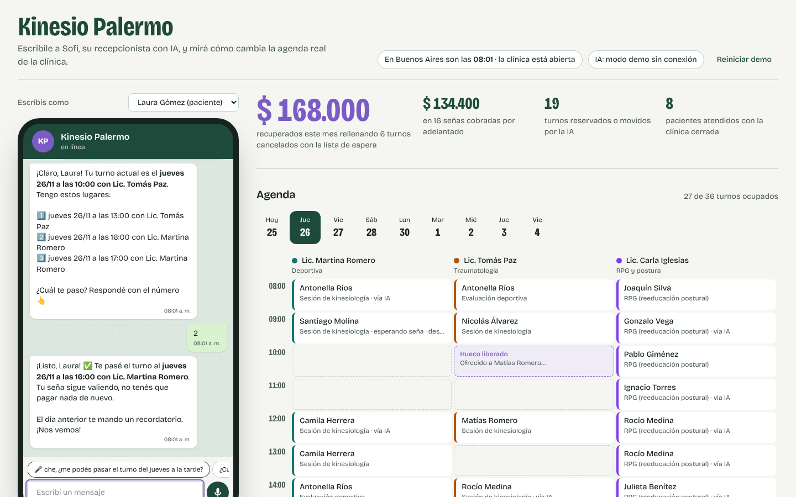

# Recepción 24/7 · una recepcionista con IA para clínicas

Demo de la **Fábrica**: módulos reutilizables para construir software para pymes de Latinoamérica en días, no en semanas.

Un paciente le manda un audio a las 23:40 a su clínica: *"¿Me puedes pasar la cita del jueves a la tarde?"*.
Sofi, la asistente con IA, entiende el audio, le ofrece tres horarios libres reales, mueve el turno y, en el mismo instante,
ofrece el hueco que quedó libre a la primera persona de la lista de espera. Cuando esa persona acepta, el panel de la clínica
suma ese turno al dinero recuperado del mes.



## Qué resuelve para la clínica

| Problema del negocio | Qué hace Recepción 24/7 |
|---|---|
| Los pacientes escriben de noche y nadie contesta | Responde al instante, 24 h, también audios |
| Ausencias y cancelaciones de último momento | Ofrece el hueco a la lista de espera automáticamente |
| Citas reservadas que después no se cumplen | Pide un anticipo por Mercado Pago para confirmar |
| La recepcionista pasa el día en WhatsApp | Reserva, mueve y cancela sola; la clínica solo mira el panel |

## Probala en 1 minuto

```bash
npm install
npm run dev
```

Abrí http://localhost:3000. No hace falta ninguna API key: sin configuración funciona el **agente demo sin conexión**,
que entiende el español coloquial de varios países, con sus modismos ("pásame la cita", "a la tarde", "tipo 5", "la segunda").

### Guion para el vídeo de 60 segundos
1. Escribiendo como Laura, toca el chip del audio: *"¿Me puedes pasar la cita del jueves a la tarde?"*.
2. Responde `1`. La cita de Laura se ilumina en la agenda del jueves.
3. A las 10:00 aparece "Hueco liberado, ofrecido a…". A los 8 segundos lo acepta alguien de la lista de espera y sube el dinero recuperado.
4. Cambia a "Número nuevo", pide una cita de RPG, elige una opción y di tu nombre: llega la tarjeta de anticipo.
5. Págalo en el checkout de prueba: la cita pasa a confirmada.

## Con IA real, WhatsApp real y cobros reales

Copiá `.env.example` a `.env.local` y completá lo que quieras activar:

- **IA**: `ANTHROPIC_API_KEY` usa Claude con herramientas (buscar horarios, reservar, mover, cancelar).
  También acepta cualquier gateway compatible con OpenAI (`OPENAI_COMPATIBLE_BASE_URL`), por ejemplo OmniRoute u Ollama.
  Si el modelo falla, la conversación sigue con el agente demo.
- **WhatsApp Cloud API**: webhook en `/api/whatsapp/webhook`, con verificación de firma `X-Hub-Signature-256`.
- **Mercado Pago**: `MERCADOPAGO_ACCESS_TOKEN` crea preferencias de Checkout Pro; el webhook `/api/pagos/webhook`
  confirma el pago consultando la API (nunca confía en el cuerpo de la notificación).

## Cómo está hecho

```
src/fabrica/
  negocio/config.ts      lo único que cambia entre clientes
  agenda/                motor de turnos puro: reservas, anticipos, lista de espera, métricas
  agente/                herramientas compartidas + agente demo + agente LLM (AI SDK)
  pagos/ whatsapp/       integraciones reales, activadas por variables de entorno
src/app/                 sala de demo, checkout de prueba y API
tests/                   motor y agente (incluye el guion completo de la demo)
```

- **Next.js 16 + TypeScript estricto + Tailwind 4.**
- **Motor sin dependencias**: el mismo código sirve para gimnasios, barberías o consultorios cambiando solo la configuración.
- **Seguridad**: cada número solo ve y modifica sus propias citas; entradas validadas con Zod; webhooks firmados.
- **Calidad**: tests con Vitest y CI en GitHub Actions (typecheck, tests y build en cada push).

## Adaptarla a otro negocio

1. Duplica `src/fabrica/negocio/config.ts` con los servicios, profesionales, horarios (el registro es siempre neutro con tuteo).
2. Ajusta la semilla de demo (`agenda/semilla.ts`) con nombres creíbles del país.
3. `npm test` y listo.

---
Hecho por [Jorge Lamelas](https://github.com/DeadY2J) con Claude Code.
